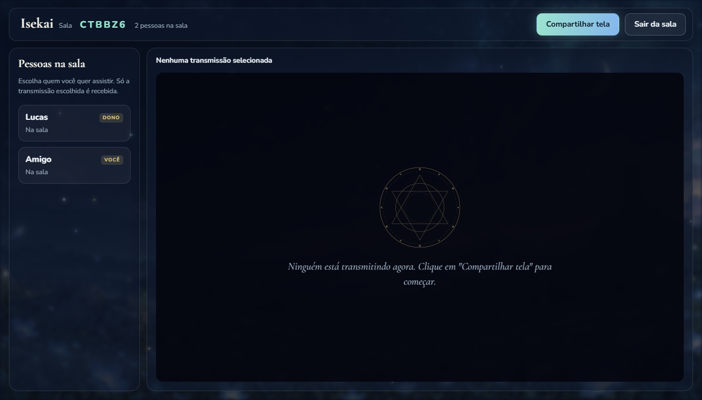

# Isekai

Programa de Windows para assistir filme e série com os amigos: todo mundo entra na mesma sala, quem vai passar o filme compartilha a janela do player e **só o som desse programa** vai para a sala. A voz da call no Discord não vaza junto.


## Baixar

**[⬇ Baixar o instalador do Isekai](https://github.com/Lucas-Amaralz/isekai/releases/latest/download/Isekai-Setup.exe)**: instala sem pedir administrador e, depois disso, **se atualiza sozinho** (quando sai versão nova, ele baixa e pergunta se pode reiniciar).

Na primeira vez o Windows pode mostrar "O Windows protegeu o computador" (o programa não tem assinatura paga). Clique em **Mais informações → Executar assim mesmo**.

Precisa de Windows 10 (versão 2004 ou mais nova) ou Windows 11.

### Assistir pelo celular

**[📱 Abrir o Isekai no celular](https://lucas-amaralz.github.io/isekai/)**: funciona no Android e no iPhone, sem instalar. Coloque seu nome e a senha da sala, entre e toque em quem está transmitindo. Pelo celular dá para assistir; transmitir é só pelo programa de Windows.

Dica: no menu do navegador, **Adicionar à tela inicial** deixa o Isekai com ícone de app.

## Como usar

1. Coloque seu nome e a **senha da sala** (a que vocês combinaram) e clique em **Entrar na sala**. Quem não sabe a senha não acha a sala nem vê nada.
2. Quem vai passar o filme clica em **Compartilhar tela**, escolhe a janela do player e, embaixo, de qual programa sai o som.
3. Para assistir, clique no nome de quem está **Transmitindo**. Duplo clique no vídeo deixa em tela cheia.
4. Para mudar de janela no meio da transmissão, clique em **Trocar tela**: quem está assistindo continua conectado e a imagem muda na hora.



A qualidade começa em 720p; com internet boa dá para escolher 1080p na hora de compartilhar.

### Avisos

- Netflix, Prime e Disney+ no navegador aparecem pretos por causa da proteção contra cópia deles (o Discord tem o mesmo limite).
- O Windows pode avisar "IsekaiAudio está usando o microfone": é como o Windows chama a captura de som de um programa. O microfone não é usado.
- A senha nunca vai pela internet: ela vira o endereço da sala e uma chave, e quem entra prova que sabe a senha sem mandar ela. A imagem e o som vão criptografados (WebRTC) direto entre os PCs.
- Quem entra primeiro segura a sala. Se essa pessoa fechar o Isekai, o de outro assume sozinho em alguns segundos, e quem estava transmitindo continua.

## Como funciona

- **Electron** para a janela e a captura de tela.
- **WebRTC** (via [PeerJS](https://peerjs.com/)) para o vídeo ir direto de quem transmite para quem assiste, sem servidor no meio. O servidor público do PeerJS só apresenta os PCs um ao outro.
- **Som de um programa só**: `helper/IsekaiAudio.cs` usa a captura por processo do Windows (`AUDIOCLIENT_PROCESS_LOOPBACK`), a mesma ideia do Discord. O PCM vai para um AudioWorklet e vira uma faixa da transmissão, sincronizada com a imagem.
- Vídeo em **H264 codificado pela placa de vídeo** quando disponível, Opus estéreo em 256 kbps para o som.

## Rodar o código

```bash
npm ci                             # instala exatamente o que está no package-lock.json
node node_modules/electron/install.js  # o .npmrc bloqueia scripts de instalação; o do Electron roda à mão
npm run build-audio   # compila o capturador de som com o csc que já vem no Windows
npm start
```

`npm run dist` gera o instalador `dist/Isekai-Setup.exe` e o `latest.yml` que o Isekai usa para se atualizar (os dois vão na Release, junto com o `.blockmap` e o `.sig`).

**Atualizações assinadas:** no fim do `npm run dist`, `scripts/assinar.js` assina o instalador com uma chave Ed25519 que fica só no PC de quem publica (`~/.isekai/assinatura-privada.pem`, nunca no repositório). O Isekai instalado baixa `Isekai-Setup.exe.sig` e só aplica a atualização se a assinatura bater com a chave pública do `main.js`. Quem conseguir mexer na Release consegue trocar o `.exe`, mas não consegue assiná-lo.

Arte de fundo gerada no Figma; fontes Cormorant Garamond e Nunito (SIL Open Font License).
