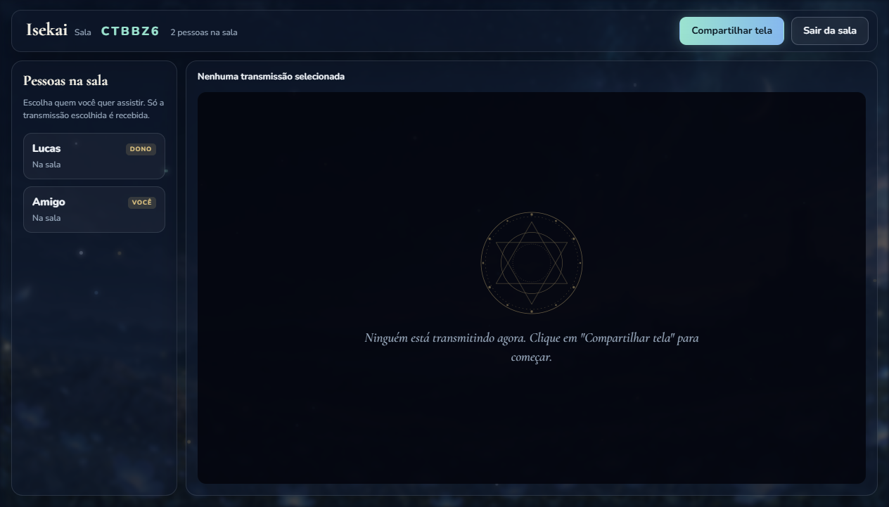

# Isekai

Programa de Windows para assistir filme e série com os amigos: cada um entra numa sala com um código, quem vai passar o filme compartilha a janela do player e **só o som desse programa** vai para a sala. A voz da call no Discord não vaza junto.


## Baixar

**[⬇ Baixar o Isekai.exe](https://github.com/Lucas-Amaralz/isekai/releases/latest/download/Isekai.exe)**: não precisa instalar, é só abrir.

Na primeira vez o Windows pode mostrar "O Windows protegeu o computador" (o programa não tem assinatura paga). Clique em **Mais informações → Executar assim mesmo**.

Precisa de Windows 10 (versão 2004 ou mais nova) ou Windows 11.

## Como usar

1. Coloque seu nome e clique em **Criar sala**. Clique no código no topo para copiar e mande para o pessoal.
2. Os outros colocam o código e clicam em **Entrar**.
3. Quem vai passar o filme clica em **Compartilhar tela**, escolhe a janela do player e, embaixo, de qual programa sai o som.
4. Para assistir, clique no nome de quem está **Transmitindo**. Duplo clique no vídeo deixa em tela cheia.



A qualidade começa em 720p; com internet boa dá para escolher 1080p na hora de compartilhar.

### Avisos

- Netflix, Prime e Disney+ no navegador aparecem pretos por causa da proteção contra cópia deles (o Discord tem o mesmo limite).
- O Windows pode avisar "IsekaiAudio está usando o microfone": é como o Windows chama a captura de som de um programa. O microfone não é usado.
- A sala fica no PC de quem criou: se essa pessoa fechar o Isekai, a sala acaba.

## Como funciona

- **Electron** para a janela e a captura de tela.
- **WebRTC** (via [PeerJS](https://peerjs.com/)) para o vídeo ir direto de quem transmite para quem assiste, sem servidor no meio. O servidor público do PeerJS só apresenta os PCs um ao outro.
- **Som de um programa só**: `helper/IsekaiAudio.cs` usa a captura por processo do Windows (`AUDIOCLIENT_PROCESS_LOOPBACK`), a mesma ideia do Discord. O PCM vai para um AudioWorklet e vira uma faixa da transmissão, sincronizada com a imagem.
- Vídeo em **H264 codificado pela placa de vídeo** quando disponível, Opus estéreo em 256 kbps para o som.

## Rodar o código

```bash
npm install
npm run build-audio   # compila o capturador de som com o csc que já vem no Windows
npm start
```

`npm run dist` gera o `dist/Isekai.exe` portátil.

Arte de fundo gerada no Figma; fontes Cormorant Garamond e Nunito (SIL Open Font License).
